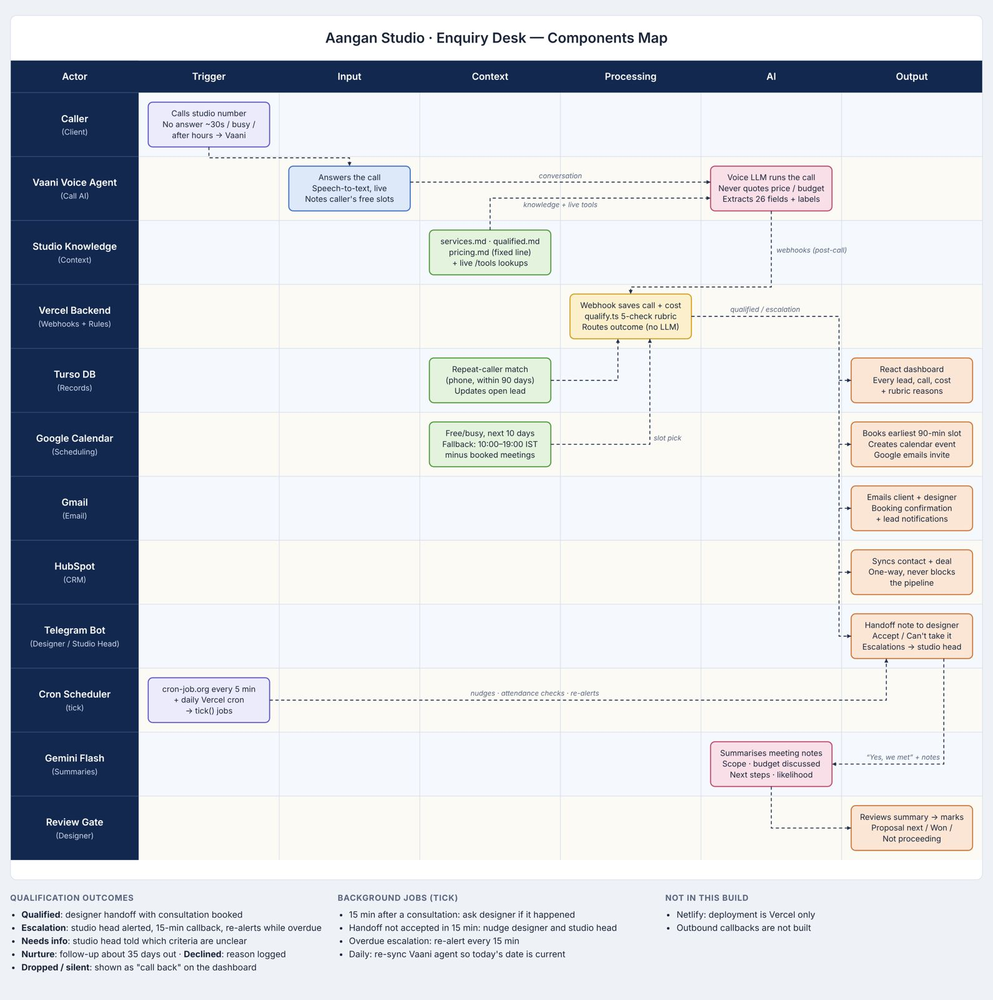
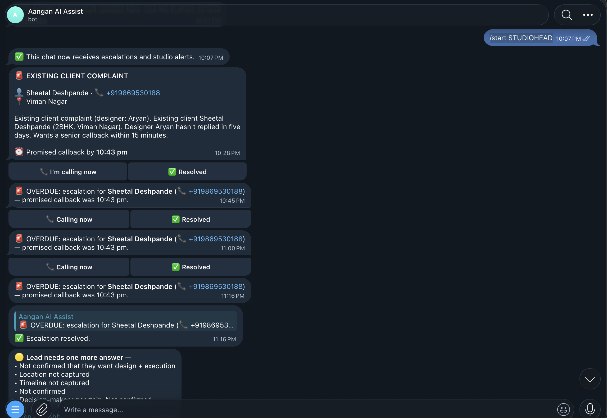
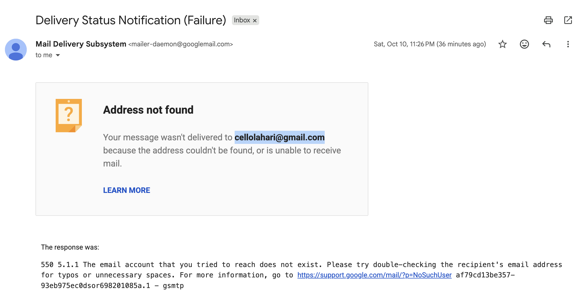

# Aangan Enquiry Desk

AI front desk for Aangan Studio's **incoming phone calls**: every call answered day or night, qualified against Nikhil's rubric, handed to a designer with everything already asked, consultation booked, and every step tracked on a dashboard (including what the system costs to run).

Source of truth for behaviour: `services.md`, `qualified.md`, `pricing.md` (these win over any other notes).

## How a call flows

```
Studio number ──(no answer after ~30 s / busy / after hours)──▶ Vaani number ──▶ Vaani voice agent
                                                                                    │
                                     call_started / call_ended / call_postprocessing (webhook)
                                                                                    ▼
                                                                server  /webhooks/vaani
                                                                                    │
                    extracted fields ──▶ rules/qualify.ts (Nikhil's 5 checks + services.md scope)
                                                                                    │
     ┌──────────────────────┬───────────────────────────┬───────────────────┬──────┴─────────┐
  qualified             existing-client complaint     declined           nurture        dropped/silent
     │                        │                        (reason logged)   (re-engage    (shown as "call back")
  pick designer + free slot   Telegram to studio head                    in ~5 weeks)
  (seniors for villas,        + 15-min callback SLA,
  offices, 2,500+ sq ft,      re-alerts if overdue
  frustrated callers,
  Nikhil's referrals)
     │
  calendar invite (Google, optional) + Telegram handoff note [Accept] [Can't take it]
     │                                    └─ reassigns to the next designer
  15 min after the consultation ends → Telegram: "Did it happen?"
     ├─ Yes → designer types notes → Gemini summary (scope, budget discussed, next steps, likelihood)
     │        → [Proposal next] [Won] [Not proceeding]
     └─ No-show / designer missed / rescheduled → "What happened?" → reason stored
```

Every step is written to the lead's timeline, shown on the dashboard, and (optionally) synced to HubSpot.

## Components map

How each part of the app interacts, from the caller's trigger through context, processing and AI to every output (dashboard, calendar, email, CRM, Telegram), plus the background cron jobs:



## See it working

**Live dashboard:** https://aangan-enquiry-desk-beta.vercel.app/


The Overview page shows how the phone line is doing: calls answered (including out-of-hours calls the front desk would have missed), leads qualified for a designer, call → designer handoff time, the funnel from call to signed project, and why enquiries were declined.

### Example leads (with call recordings)

| Lead                                                             | Outcome                            | Call recording                                                                                                                                                                                                                                                                                                              |
| ---------------------------------------------------------------- | ---------------------------------- | --------------------------------------------------------------------------------------------------------------------------------------------------------------------------------------------------------------------------------------------------------------------------------------------------------------------------- |
| [Lead #23](https://aangan-enquiry-desk-beta.vercel.app/leads/23) | ✅ Qualified, handed to a designer | [Listen](https://app.vaanivoice.ai/api/stream/webrtc-1791654838-979a9dbe?token=d2VicnRjLTE3OTE2NTQ4MzgtOTc5YTlkYmV8YmRkYjYxYmItOTJhYS00YjU0LWJmNDUtOTZlM2Y3M2VmN2RlfGM1NWNjY2FhLWMxNmEtNGViYS05OTIwLTZkNzAxOGEyYTE3OHwxNzk5NDMwOTcyfDVhZTJlMjdiOGQ1ZDQwMDdjYTBkNzc4MmEzZmY4ZWM3YzQyYTYxNGVkNjczMTU5NDU4OWYwZDk3NjEzNjVjYWM) |
| [Lead #22](https://aangan-enquiry-desk-beta.vercel.app/leads/22) | ❌ Declined (not a fit)            | [Listen](https://app.vaanivoice.ai/api/stream/webrtc-1791653107-be1aecc5?token=d2VicnRjLTE3OTE2NTMxMDctYmUxYWVjYzV8YmRkYjYxYmItOTJhYS00YjU0LWJmNDUtOTZlM2Y3M2VmN2RlfGM1NWNjY2FhLWMxNmEtNGViYS05OTIwLTZkNzAxOGEyYTE3OHwxNzk5NDI5MjEyfDE1OTAyMDk1NGRlZDQ2MGM3NWExODBkYWE4NzA0M2VjMDAyYjgwMWYzNmI2MDk2ODgzMzEwZjBlNDkyZjgzNmQ) |

Each lead page shows the rubric result per criterion with the reason, the extracted fields, and the full timeline.

### Telegram notifications

The studio head links their Telegram chat with `/start STUDIOHEAD` and from then on receives escalations and studio alerts. Below, an existing-client complaint (T09, replayed with `npm run simulate`) arrives with the promised 15-minute callback time and one-tap **I'm calling now** / **Resolved** buttons. When the callback deadline passes without a resolution, the bot re-alerts with an **OVERDUE** message every ~15 minutes until someone taps **Resolved**. It also flags leads that still need one more answer (e.g. location, timeline or decision-maker not captured) so a human can follow up:



### Automatic email to the caller

Booking confirmations are emailed to the client and the designer automatically, with no manual step. In this test call the caller intentionally gave an incorrect email address, so the message bounced, which shows the tool really sent it:



## Decisions (and why)

| Decision                                                           | Why                                                                                                                                                                                                                                                               |
| ------------------------------------------------------------------ | ----------------------------------------------------------------------------------------------------------------------------------------------------------------------------------------------------------------------------------------------------------------- |
| **No prices on the call**, ever — one fixed line from `pricing.md` | Nikhil asked for per-sq-ft quotes; `pricing.md` forbids any number. This is the cut. A `pricing_leak` check runs on every call and shows on the dashboard.                                                                                                        |
| **Rubric in code, not in the LLM** (`server/src/rules/`)           | Deterministic and explainable: each lead shows pass/fail/unclear per criterion with the reason. Tested against the September enquiries (`npm test`): it reaches the studio's own decision on all 19 qualifiable phone calls, plus 7 WhatsApp/web-form edge cases. |
| **The agent never asks about budget**                              | `qualified.md`: "Don't probe." A volunteered budget is checked internally against the lowest pricing tier (×0.6); only a clear miss (T10: ₹1–1.5 L for kitchen + bedroom) is flagged.                                                                             |
| **Telegram for the handoff** (over email)                          | Designers are on site all day; the 1-hour, 4× conversion window needs a push notification, not an inbox. Buttons make Accept / Met / No-show a single tap, which is what makes attendance tracking possible at all. The calendar invite still goes by email.      |
| **Booking happens after the call** (mid-call slot tools optional)  | Works with any Vaani plan and needs no low-latency public endpoint. The agent collects preferred days/times; the server books the earliest matching designer slot within seconds. Add the `/tools/*` cURL tools in Vaani to offer exact slots live.               |
| **Own SQLite DB as source of truth; HubSpot is a one-way sync**    | The ops data Nikhil asked for (call cost, speed to designer, no-show reasons) doesn't fit HubSpot's free objects. HubSpot gets contacts and deals for the pipeline view.                                                                                          |
| **Outbound callbacks parked**                                      | Scope is incoming calls. Dropped/missed calls are listed as "call back" on the dashboard.                                                                                                                                                                         |

## Run it locally

```bash
npm install            # workspaces: server + web
npm run build          # build the dashboard
npm run seed           # placeholder designers + September baseline
npm start              # http://localhost:4000
npm test               # rubric tests (September transcripts)
npm run simulate       # replay 6 realistic Vaani webhooks
npm run check          # verify every integration with a real API call
```

## Deploy (free: Vercel Hobby + Turso free tier)

The Express app runs as one Vercel function (`api/index.ts`); the dashboard is static (`web/dist`); data lives in Turso (SQLite-compatible, provisioned through the Vercel Marketplace — `TURSO_DATABASE_URL` / `TURSO_AUTH_TOKEN`). Locally the same code uses `server/aangan.db`.

```bash
npm run deploy                          # push .env to Vercel production env, deploy --prod
npm run telegram:setup -- https://<prod-url>   # point the bot's webhook at production, print designer links
npm run google:auth                     # one-time Google sign-in → GOOGLE_REFRESH_TOKEN in .env (then deploy again)
```

Then in Vaani → Settings → Webhooks add `https://<prod-url>/webhooks/vaani?key=<WEBHOOK_SECRET>`, and create a free cron-job.org job hitting `https://<prod-url>/cron/tick?key=<CRON_SECRET>` every 5 minutes (Vercel Hobby cron is daily only). The Setup page in the dashboard shows the exact URLs and what's still missing.

## Integrations

|                           | Needed for                                            | Set in `.env`                                                                              |
| ------------------------- | ----------------------------------------------------- | ------------------------------------------------------------------------------------------ |
| Vaani                     | the voice agent + call webhooks                       | `VAANI_API_KEY`, `VAANI_AGENT_ID` (auto), `WEBHOOK_SECRET`                                 |
| Turso                     | hosted database                                       | `TURSO_DATABASE_URL`, `TURSO_AUTH_TOKEN` (Vercel Marketplace)                              |
| Telegram                  | designer handoff, check-ins, escalations              | `TELEGRAM_BOT_TOKEN` (@BotFather), `TELEGRAM_WEBHOOK_SECRET` (auto)                        |
| Google Calendar           | real availability + invites                           | `GOOGLE_CLIENT_ID`, `GOOGLE_CLIENT_SECRET`, `GOOGLE_REFRESH_TOKEN` (`npm run google:auth`) |
| HubSpot                   | founder pipeline view                                 | `HUBSPOT_TOKEN` (private app: contacts + deals read/write)                                 |
| Gemini (Flash, free tier) | structured consultation summaries from designer notes | `GEMINI_API_KEY`, `GEMINI_MODEL` (optional, defaults to `gemini-3.8-flash`)                |
| —                         | cron                                                  | `CRON_SECRET`                                                                              |

## Layout

```
server/src
  vaani/agentConfig.ts   prompt, greeting, 26 extraction fields, dispositions (pushed to Vaani)
  vaani/webhook.ts       call events → calls table → pipeline
  rules/                 qualify.ts (5 checks), serviceArea.ts, timeline.ts, budget.ts (internal only)
  pipeline.ts            qualify → handoff/booking, escalations, meeting outcomes, notes
  scheduling/calendar.ts slots from working hours + bookings, Google free/busy + invites
  notify/                Telegram send/poll + bot conversation
  crm/hubspot.ts         contact + deal sync
  ai/summarise.ts        consultation notes → structured summary (Gemini)
  jobs.ts                meeting check-ins, accept SLA nudges, overdue escalations, daily prompt date
  api/routes.ts          dashboard API (overview metrics, calls, leads, escalations, designers)
  tools/routes.ts        optional mid-call tools (date, service area, budget fit, slots)
web/src                  React dashboard (Overview, Calls, Leads, Lead detail, Escalations, Designers, Setup)
```

## Extending to WhatsApp and the web form (not built)

Both channels produce the same fields the voice agent extracts. A WhatsApp agent (Vaani supports WhatsApp) or a form handler would write a `calls`-like row and call `processCall`, so rubric, handoff, booking, tracking and the dashboard all work unchanged. The web form already collects most of the rubric fields directly.
